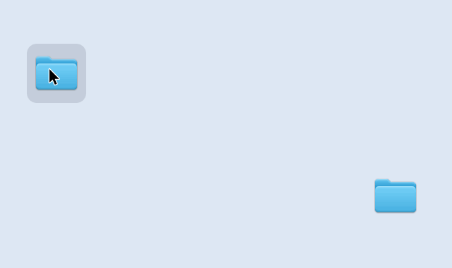
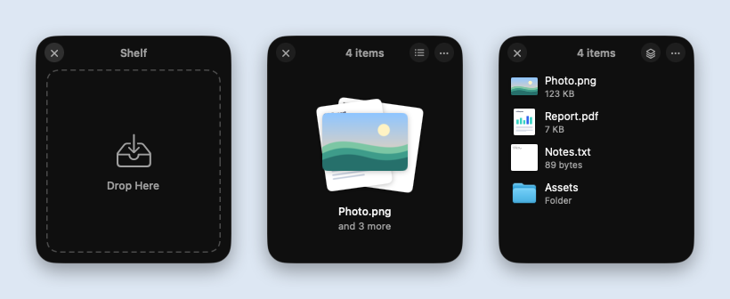

<p align="center"></p>

<h1 align="center">TmpSquare</h1>

<p align="center">Shake to open a temporary spot for your files.</p>

<p align="center">
  <a href="https://github.com/Izu-TABI/TmpSquare/releases/latest"></a>
  
  <a href="LICENSE"></a>
  <a href="https://github.com/Izu-TABI/TmpSquare/releases"></a>
</p>

<p align="center">English | <a href="README.md">日本語</a></p>

<p align="center"></p>

TmpSquare is a Mac menu bar app: shake the cursor left and right while dragging files, and a "shelf" appears right there. Park your files on it, open the destination folder or app, then drag them all out at once. It's a free and open-source shelf app in the spirit of Dropover and Yoink — great for gathering files from several windows or moving files around without cluttering your desktop.

## Features

- **Just shake**: The shelf appears where you shake while dragging and follows the cursor until your hand settles, so you can drop right onto it. ⌥⇧Space opens one too.
- **Drag everything out at once**: Drag the card stack to take out everything you've parked. Switch to the list to drag items one by one.
- **Holds almost anything**: Files and folders, plus images, links, text, and attachments from Photos or Mail. Right-click to share or compress to ZIP.
- **No permissions needed**: Works without granting Accessibility or Input Monitoring access.
- **No network access**: Never connects to the internet, and never collects or sends any data.
- **Free and open source**: MIT License. Available in English and Japanese, and runs natively on both Apple silicon and Intel (under 1 MB zipped).

<p align="center"></p>

## Download

**[Download TmpSquare.zip](https://github.com/Izu-TABI/TmpSquare/releases/latest/download/TmpSquare.zip)** (macOS 14 or later, Apple silicon / Intel)

1. Open the zip and move `TmpSquare.app` to your Applications folder.
2. Open `TmpSquare.app`. The app isn't notarized by Apple, so the first time you'll see a warning that it was not opened. Click **Done**.
3. Open **System Settings → Privacy & Security**, scroll down, and click **Open Anyway** next to TmpSquare. Confirm with **Open Anyway** again.

If you use Terminal, you can also install it with Homebrew (you'll still need to click **Open Anyway** the first time):

```bash
brew install --cask izu-tabi/tap/tmpsquare
```

You're all set when the guide opens. The app appears in English or Japanese depending on your Mac's language settings (Japanese if it's listed above English). Older versions are on the [Releases](https://github.com/Izu-TABI/TmpSquare/releases) page.

## Usage

1. While dragging files, shake the cursor left and right (or press ⌥⇧Space, or choose **New Shelf** from the menu bar).
2. Drop the files on the shelf. You can keep adding more.
3. Open the destination folder or app, then drag the card stack out of the shelf.

### All actions

| Action | Result |
| --- | --- |
| Shake the cursor left and right while dragging files | A shelf opens at the center of the shake and follows the cursor until your hand settles |
| ⌥⇧Space / **New Shelf** in the menu bar | Opens an empty shelf |
| Drop onto the shelf | Adds files, folders, images, links, text, and attachments from Photos or Mail |
| Drag the card stack | Drags all items out at once |
| Click the cards / the list button | Switches to the list view (drag items one by one, double-click to open) |
| Right-click / the "…" button | Open, Show in Finder, Share, Copy, Copy Path, Compress to ZIP, Remove from Shelf |
| Drag the header | Moves the shelf |
| ✕ / esc | Closes the shelf |

- When you drop into Finder, it behaves just like Finder (moves on the same disk; hold ⌥ to copy).
- Items you drag out are removed from the shelf, and an emptied shelf closes automatically (configurable in the menu).
- Shake detection on/off, shake sensitivity, and Open at Login are in the menu bar icon's menu, along with **How to Use**, which reopens the guide anytime.

## How it works and limitations

- For shake detection, TmpSquare only looks at the cursor position while a mouse button is held down, and only reacts when something is being dragged (when the drag pasteboard changes). It doesn't look at your keystrokes.
- A shelf only remembers where your files are — it doesn't copy them. Only things that don't exist as files yet, like image data or Mail attachments, are saved to `~/Library/Caches/com.odentabetai.TmpSquare/Items`, which is cleared on the next launch.
- A shelf's contents are cleared when you quit the app (your original files stay where they are).
- On macOS 26, shelves use Liquid Glass.

## Building from source

### Requirements

- macOS 14 or later
- Xcode Command Line Tools (the full Xcode app is not required)

### Build and run

```bash
./scripts/build.sh --run       # build build/TmpSquare.app and launch it
./scripts/build.sh --install   # install to /Applications and launch it
./scripts/test.sh              # run the tests
```

### Regenerating the README images

```bash
./scripts/make-demo.sh
```

Runs the real shelf, records it frame by frame, and composites a cursor and dragged files on top (demo GIFs, screenshots, and the social preview, in English and Japanese). It never captures the whole screen, so no other apps or personal information end up in the images. A shelf briefly appears in the center of the screen while recording.

### Publishing a release

Bump `CFBundleShortVersionString` in `Resources/Info.plist`, commit and push, then run the script below. It builds a universal app (Apple silicon and Intel), publishes a `v<version>` release on GitHub with `TmpSquare.zip` attached, and finally updates the Homebrew tap ([Izu-TABI/homebrew-tap](https://github.com/Izu-TABI/homebrew-tap)).

```bash
./scripts/release.sh
```

## Project layout

```
Sources/TmpSquare/
├── App/        launch, menu bar, first-run guide, settings, global hotkey
├── Shake/      shake detection while dragging
├── Shelf/      shelf window, state, importing drops, actions
├── Views/      SwiftUI views and AppKit-based drag-out
└── Support/    English strings, temporary storage, ZIP creation, menu item helpers
Tests/TmpSquareTests/   tests for shake detection, shelf placement, importing, drop handling, ZIP
scripts/        build, test, release, Homebrew update, icon and README image generation
docs/images/    README images
```

## Debug options (debug builds only)

```bash
swift build
.build/debug/TmpSquare --open-shelf --expanded ~/Desktop/a.pdf ~/Desktop/b.png
```

`--open-shelf` opens a shelf with the given items in the center of the screen. The app can write its own window to a PNG, so you can check the UI without screen recording permission.

| Option | Description |
| --- | --- |
| `--snapshot out.png` | Writes the shelf's appearance |
| `--filmstrip out.png` | Toggles between stack and list view and writes the frames side by side |
| `--record <dir>` | Walks through the shelf's states from empty, writes each scene's frames, then quits (for the README images) |
| `--drop-later` | Opens an empty shelf and adds the items during `--filmstrip` (the drop animation) |
| `--expanded` | Opens in list view |
| `--dark` / `--light` | Forces the appearance |
| `--key` / `--shadow` | Makes the shelf the key window before capturing / includes the window shadow |
| `--welcome out.png` | Writes the guide window, then quits |

Add `-AppleLanguages "(en)"` to check the English UI. Animation timings are collected in `ShelfMotion` in `Sources/TmpSquare/Views/ShelfView.swift`.

## License

[MIT License](LICENSE)
