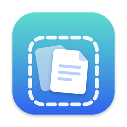
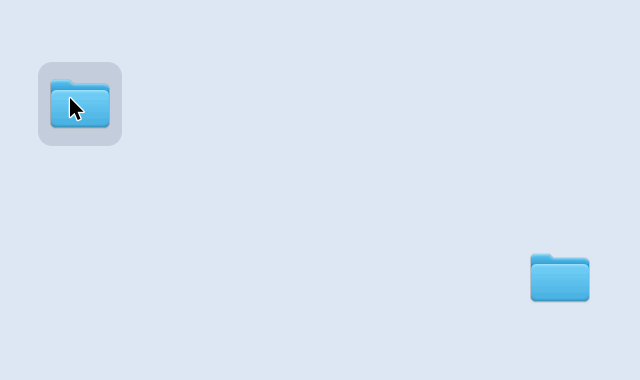
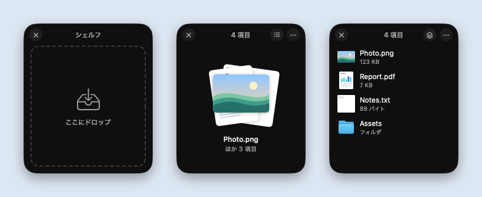

<p align="center"></p>

<h1 align="center">TmpSquare</h1>

<p align="center">振れば出てくる、ファイルの一時置き場。</p>

<p align="center">
  <a href="https://github.com/Izu-TABI/TmpSquare/releases/latest"></a>
  
  <a href="LICENSE"></a>
  <a href="https://github.com/Izu-TABI/TmpSquare/releases"></a>
</p>

<p align="center"><a href="README.en.md">English</a> | 日本語</p>

<p align="center"></p>

ファイルをドラッグしながらカーソルを左右に振ると、その場に「シェルフ」が現れる Mac のメニューバーアプリです。ファイルをいったんそこに置いておき、移動先のフォルダやアプリを開いてから、まとめてドラッグして取り出せます。Dropover や Yoink のような「シェルフ」アプリを、無料・オープンソースで使えます。いくつものウィンドウからファイルを集める、デスクトップを散らかさずにファイルを運ぶ、といった使い方に向いています。

## 特長

- **振るだけで出てくる**：ドラッグしながら振った場所に現れ、手が止まるまでカーソルについてくるので、そのままドロップできます。⌥⇧Space でも開けます。
- **まとめて取り出せる**：重なったカードをドラッグすれば、置いたファイルを全部まとめて取り出せます。一覧にすれば 1 つずつも取り出せます。
- **何でも置ける**：ファイルやフォルダのほか、画像・リンク・テキスト・写真アプリや Mail の添付も置けます。右クリックで共有や ZIP への圧縮もできます。
- **許可が要らない**：「アクセシビリティ」や「入力監視」を許可しなくても使えます。
- **通信しない**：ネットワークには一切接続しません。データを集めたり送ったりもしません。
- **無料・オープンソース**：MIT ライセンス。日本語と英語に対応し、Apple シリコンと Intel の両方でネイティブに動きます（zip で 1MB 未満）。

<p align="center"></p>

## ダウンロード

**[TmpSquare.zip をダウンロード](https://github.com/Izu-TABI/TmpSquare/releases/latest/download/TmpSquare.zip)**（macOS 14 以降、Apple シリコン / Intel）

1. zip を開き、`TmpSquare.app` を「アプリケーション」フォルダに移動します。
2. `TmpSquare.app` を開きます。Apple の公証を受けていないため、初回は「開いていません」という警告が出るので「完了」を押します。
3. 「システム設定」→「プライバシーとセキュリティ」を開き、下の方にある TmpSquare の「このまま開く」を押します。もう一度確認が出たら「このまま開く」を押します。

ターミナルを使う場合は、Homebrew でも入れられます（初回の「このまま開く」は同じく必要です）。

```bash
brew install --cask izu-tabi/tap/tmpsquare
```

使い方の案内が開いたら準備完了です。表示は Mac の言語設定に合わせて日本語か英語になります（日本語が英語より上にあれば日本語）。過去のバージョンは [Releases](https://github.com/Izu-TABI/TmpSquare/releases) にあります。

## 使い方

1. ファイルをドラッグしながら、カーソルを左右に振ります（⌥⇧Space やメニューバーの「新しいシェルフ」でも開けます）。
2. 現れたシェルフにドロップします。続けてほかのファイルも追加できます。
3. 移動先のフォルダやアプリを開き、シェルフの重なったカードをドラッグして取り出します。

### 操作の一覧

| 操作 | 動作 |
| --- | --- |
| ファイルをドラッグ中にカーソルを左右に振る | 振った範囲の中心にシェルフが開き、手が止まるまでカーソルの下についてくる |
| ⌥⇧Space / メニューバーの「新しいシェルフ」 | 空のシェルフを開く |
| シェルフにドロップ | ファイル・フォルダ・画像・リンク・テキスト・写真アプリや Mail の添付を追加 |
| 重なったカードをドラッグ | 全項目をまとめて取り出す |
| カードをクリック / 一覧ボタン | 一覧表示にする（1 項目ずつドラッグ、ダブルクリックで開く） |
| 右クリック / 「…」ボタン | 開く・Finder で表示・共有・コピー・パスをコピー・ZIP に圧縮・シェルフから外す |
| ヘッダーをドラッグ | シェルフを移動 |
| ✕ / esc | シェルフを閉じる |

- 取り出し先が Finder の場合は Finder と同じ動作になります（同じディスクなら移動、⌥ を押しながらでコピー）。
- 取り出した項目はシェルフから外れ、空になったシェルフは自動で閉じます（メニューで変更できます）。
- シェイクの有効／無効と感度、ログイン時の起動はメニューバーのアイコンから設定できます。使い方の案内もそこからいつでも開けます。

## 仕組みと制限

- シェイクは、マウスボタンを押しているあいだだけカーソルの位置を見て、何かをドラッグしているとき（ドラッグ用のペーストボードが更新されたとき）だけ判定しています。キー入力は見ていません。
- シェルフはファイルの「場所」を覚えているだけで、ファイルをコピーしません。画像データやメールの添付など、ファイルとして存在しないものだけ `~/Library/Caches/com.odentabetai.TmpSquare/Items` に保存し、次回の起動時に削除します。
- シェルフに置いた内容は、アプリを終了すると消えます（元のファイルはそのままです）。
- macOS 26 では Liquid Glass で表示します。

## ソースからビルドする

### 必要なもの

- macOS 14 以降
- Xcode の Command Line Tools（Xcode 本体は不要）

### ビルドと起動

```bash
./scripts/build.sh --run       # build/TmpSquare.app を作って起動
./scripts/build.sh --install   # /Applications にインストールして起動
./scripts/test.sh              # テストを実行
```

### README の画像を作り直す

```bash
./scripts/make-demo.sh
```

アプリのシェルフを実際に動かしてコマ撮りし、カーソルやドラッグ中のファイルを描き足して合成します（日本語版と英語版の動作イメージ・スクリーンショット・共有用の画像）。画面全体は撮らないので、ほかのアプリや個人の情報は写りません。撮影中は画面中央にシェルフが少しの間表示されます。

### リリースを出す

`Resources/Info.plist` の `CFBundleShortVersionString` を上げてコミット・push してから実行します。Apple シリコンと Intel の両方で動く版を作り、`TmpSquare.zip` を添付した `v<バージョン>` のリリースを GitHub に公開します。最後に Homebrew の tap（[Izu-TABI/homebrew-tap](https://github.com/Izu-TABI/homebrew-tap)）も新しいバージョンに更新します。

```bash
./scripts/release.sh
```

## 構成

```
Sources/TmpSquare/
├── App/        起動処理、メニューバー、初回の案内、設定、グローバルホットキー
├── Shake/      ドラッグ中のシェイク検出
├── Shelf/      シェルフのウィンドウ・状態・ドロップの取り込み・アクション
├── Views/      SwiftUI の見た目と、AppKit で処理するドラッグアウト
└── Support/    英語の表示、一時領域、ZIP 作成、メニュー項目のヘルパー
Tests/TmpSquareTests/   シェイク判定・シェルフの位置・取り込み・ドロップ受付・ZIP のテスト
scripts/        ビルド、テスト、リリース、Homebrew の更新、アイコンと README の画像づくり
docs/images/    README の画像
```

## 開発用オプション（デバッグビルドのみ）

```bash
swift build
.build/debug/TmpSquare --open-shelf --expanded ~/Desktop/a.pdf ~/Desktop/b.png
```

`--open-shelf` で項目入りのシェルフを画面中央に開きます。画面収録の権限がなくても、自分のウィンドウを PNG に書き出して UI を確認できます。

| オプション | 内容 |
| --- | --- |
| `--snapshot out.png` | シェルフの見た目を書き出す |
| `--filmstrip out.png` | 重ね表示⇄一覧表示を切り替え、その間のコマを並べて書き出す |
| `--record <dir>` | 空のシェルフから順に操作し、各場面のコマを書き出して終了する（README の画像用） |
| `--drop-later` | 空のシェルフで開き、`--filmstrip` のときに項目を追加する（ドロップ時の動き） |
| `--expanded` | 一覧表示で開く |
| `--dark` / `--light` | 外観を固定する |
| `--key` / `--shadow` | キーウィンドウにしてから撮る／ウィンドウの影も含めて撮る |
| `--welcome out.png` | 使い方の案内を書き出して終了する |

英語の表示を確かめるときは `-AppleLanguages "(en)"` を付けます。アニメーションの速さは `Sources/TmpSquare/Views/ShelfView.swift` の `ShelfMotion` にまとめています。

## ライセンス

[MIT License](LICENSE)
